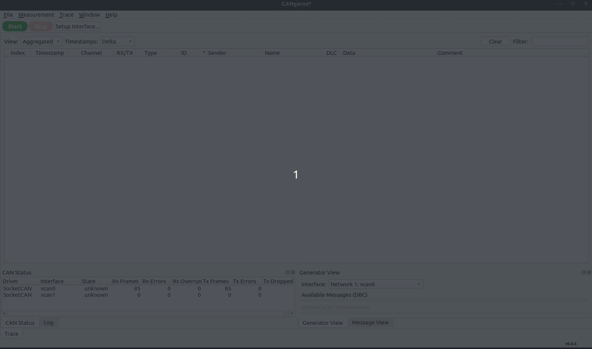
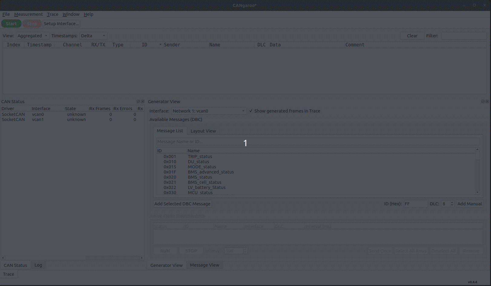
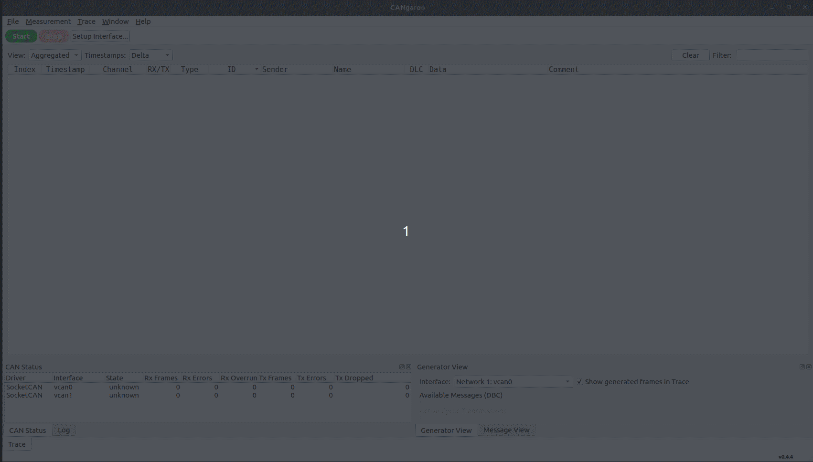
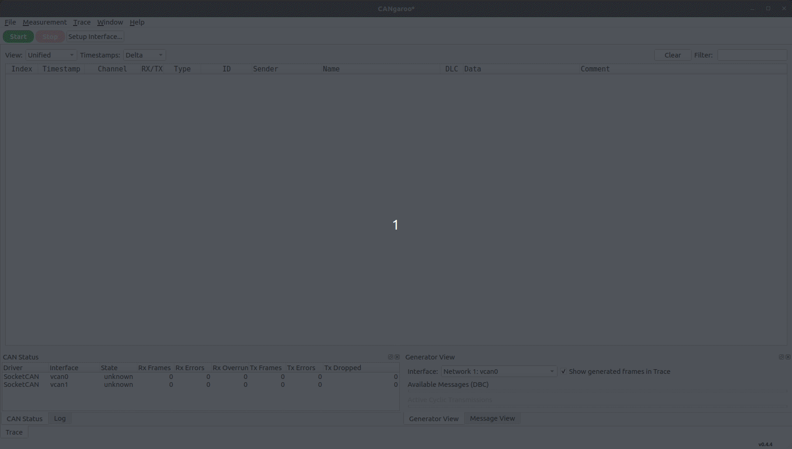
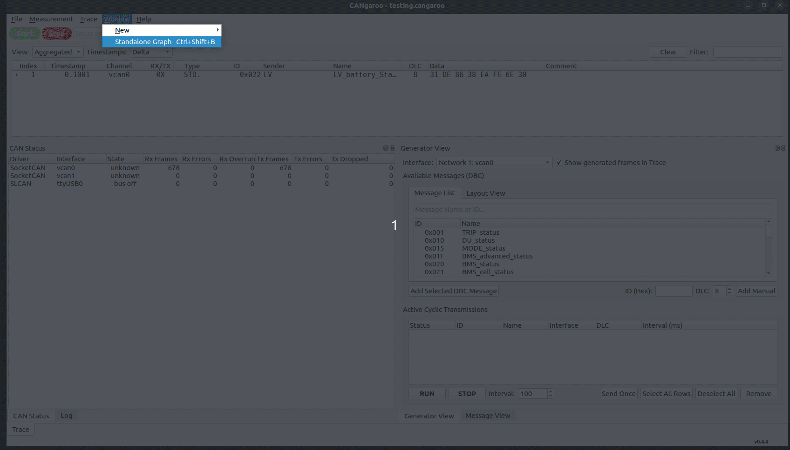
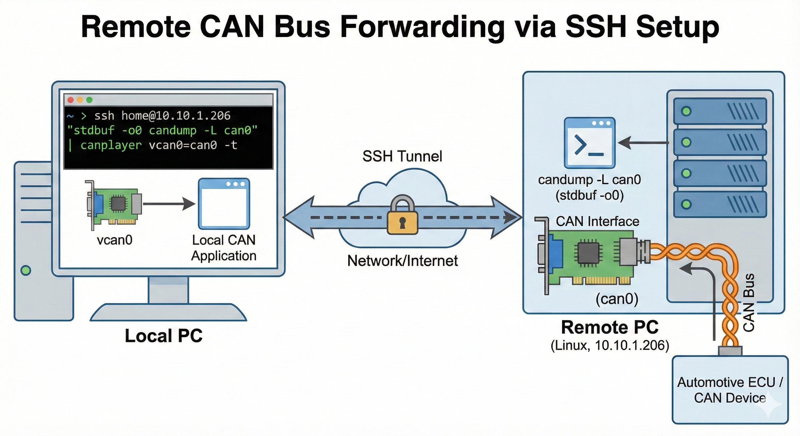
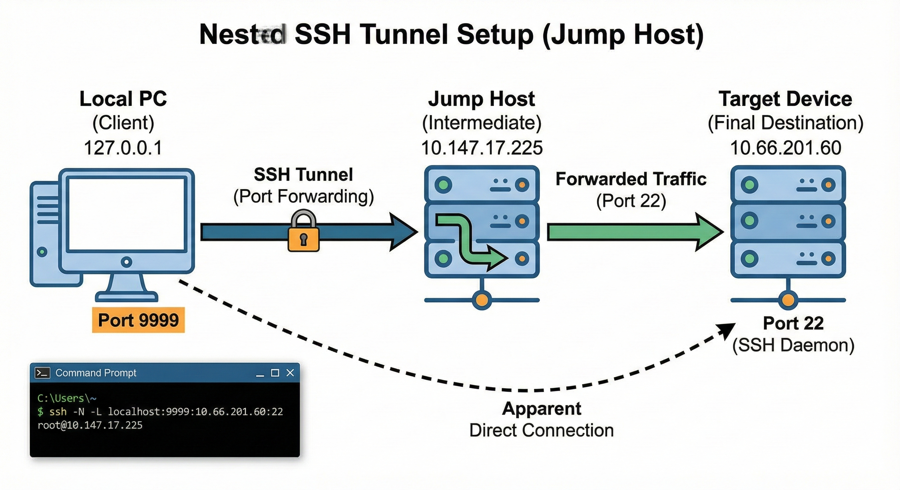

#  Cangaroo
**Open-source cross-platform CAN bus analyzer for Automotive, Robotics, and Industrial Applications**

[](https://github.com/OpenAutoDiagLabs/cangaroo/releases/latest)

[](https://github.com/OpenAutoDiagLabs/CANgaroo/actions/workflows/cmake.yml)


Cangaroo is a professional-grade CAN bus analyzer designed for engineers in **Automotive**, **Robotics**, and **Industrial Automation**. It facilitates real-time capture, decoding, and analysis of CAN and CAN‑FD traffic.

> **Works natively with SocketCAN on Linux and WinUSB/CandleAPI on Windows for immediate real hardware connections.**

---

## 🎥 Demo Gallery
*Real-time capture and decoding of CAN traffic using DBC databases.*
<br><br>
<!-- slide -->
*Simulate CAN traffic with customizable periodic and manual transmissions.* 
<br><br>
<!-- slide -->
*Seamlessly reassemble and decode UDS (Unified Diagnostic Services) messages over the ISO-TP transport layer.*
<br><br>
<!-- slide -->
*Robust analysis of J1939 heavy-duty protocols, supporting Multi-frame (BAM) reassembly and PGN identification.*
<br><br>
<!-- slide -->
*Visualize CAN signals in real-time with Time-series, Scatter charts, Text view, and interactive Gauges.*
<br><br>

---

## 🚀 Key Features

*   **Real-time CAN/CAN-FD Decoding**: Support for standard and high-speed flexible data-rate frames.
*   **Wide Hardware Compatibility**: Seamlessly works with **SocketCAN** on Linux (supports PCAN, Kvaser, etc.), **WinUSB/CandleAPI** on Windows (gs_usb/CandleLight adapters), **SLCAN**, and **CANblaster** (UDP).
*   **DBC Database Support**: Load multiple `.dbc` files to instantly decode frames into human-readable signals.
*   **Powerful Data Visualization**: Integrated Graphing tools supporting Time-series, Scatter charts, Text-based monitoring, and interactive Gauge views with zoom and live tooltips.
*   **Python Scripting API**: Automate measurement and simulation via an embedded Python engine. View the [API Documentation](cangaroo_python_api.md).
*   **Advanced Filtering & Logging**: Isolate critical data with live filters and export captures for offline analysis.
*   **Modern Workspace**: A clean, dockable userinterface optimized for multi-monitor setups.

---

## 🐍 Python Automation

CANgaroo includes an embedded Python environment that allows you to script repetitive tasks, automate complex transmission sequences, or analyze incoming traffic programmatically.

Check out the full [Python API Documentation](cangaroo_python_api.md) for examples and reference.

---

## 🛠️ Installation & Setup (Linux)

### Option 1: Build from Source
Getting started is as simple as running our automated setup script:

```bash
git clone https://github.com/OpenAutoDiagLabs/CANgaroo.git
cd CANgaroo
./install_linux.sh
```
Follow the interactive menu to install dependencies and build the project.

### Option 2: Using Release Package
If you downloaded a pre-compiled release tarball, use the included setup script to prepare your environment:

1. Extract the package: `tar -xzvf cangaroo-vX.Y.Z-linux-x86_64.tar.gz`
2. Run the setup script: `./setup_release.sh`
3. Select an option to install dependencies and/or install Cangaroo to `/usr/local/bin`.

### Manual Dependency Installation

| Distribution | Command |
| :--- | :--- |
| **Ubuntu / Debian ≤12** | `sudo apt install qt6-base-dev libqt6charts6-dev libqt6serialport6-dev build-essential libnl-3-dev libnl-route-3-dev` |
| **Debian 13+ / recent Ubuntu** | `sudo apt install qt6-base-dev qt6-charts-dev qt6-serialport-dev build-essential libnl-3-dev libnl-route-3-dev` |
| **Fedora** | `sudo dnf install qt6-qtbase-devel qt6-qtcharts-devel qt6-qtserialport-devel libnl3-devel` |
| **Arch Linux** | `sudo pacman -S qt6-base qt6-charts qt6-serialport libnl` |

---

## 🔌 Hardware Support

Cangaroo is designed to be cross-platform, offering robust hardware support on both Linux and Windows.

### Linux (SocketCAN)
Cangaroo leverages the standard Linux **SocketCAN** subsystem. This means it works with virtually any CAN interface supported by the Linux kernel.

### Windows (WinUSB / CandleAPI)
On Windows, Cangaroo includes native support for adapters running the **gs_usb** protocol (such as CANable and CandleLight) via WinUSB and the CandleAPI driver.

### Supported Hardware
*   **PEAK-System (PCAN)**: 
    *   PCAN-USB, PCAN-USB Pro, PCAN-PCIe, etc. (Native driver: `peak_usb`).
*   **Native USB-CAN Adapters**: 
    *   [CANable](https://canable.io/) (with Candlelight firmware)
    *   Kvaser USB/CAN Leaf
    *   Candlelight compatible devices (e.g., MKS CANable, cantact)
*   **USB SLCAN Adapters**:
    *   CANable (with set-default SLCAN firmware)
    *   Arduino-based CAN shields (running SLCAN sketches)
*   **Industrial / Embedded CAN**:
    *   PCIe/mPCIe CAN cards
    *   Embedded CAN controllers on SoCs (e.g., Raspberry Pi with MCP2515)
*   **Remote / Network CAN**: 
    *   [CANblaster](https://github.com/OpenAutoDiagLabs/CANblaster) (UDP)
    *   tcpcan / candlelight-over-ethernet

### Setup Instructions

#### 1. Native Drivers (gs_usb, pcan, etc.)
Most professional hardware is recognized automatically as `can0`, `can1`, etc. To bring up an interface at 500k bitrate:
```bash
sudo ip link set can0 up type can bitrate 500000
```

#### 2. USB SLCAN (Adapters using Serial/COM)
If your device uses SLCAN (like original CANable firmware), use `slcand`:
```bash
# Connect device as /dev/ttyUSB0 and set bitrate (S6 = 500k)
sudo slcand -o -s6 -t hw -S 115200 /dev/ttyUSB0 slcan0
sudo ip link set slcan0 up
```

---

## �🚦 Quick Start Guide

### 1. Zero-Hardware Testing (Virtual CAN)
```bash
sudo modprobe vcan
sudo ip link add dev vcan0 type vcan
sudo ip link set up vcan0
```

### 2. Remote CAN Monitoring (SSH Pipe)

Monitor traffic from a remote machine (e.g., a Raspberry Pi on your vehicle) on your local PC:
```bash
# On your local machine, setup vcan0 as shown above, then:
ssh user@remote-ip "candump -L can0" | canplayer vcan0=can0 -t
```
*Now open Cangaroo and connect to `vcan0` to see the remote traffic.*

#### Nested SSH Tunneling (Multi-hop)
If the target device is behind a jump host or firewall:

1. **Create an SSH Tunnel**: Expose the remote device's SSH port to your local machine.
```bash
# local-pc -> jump-host -> target-device
sshpass ssh -N -L localhost:9999:<remote-machine-ip>:22 user@jump-host-ip

eg: ssh -N -L localhost:9999:10.66.201.60:22 root@10.147.17.225
```

**Breakdown of the command:**
| Item | Description |
| :--- | :--- |
| `localhost:9999` | The local port on your **PC** that will map to the target device. |
| `10.66.201.60` | The Internal IP of the **Remote Linux Device** (Target). |
| `22` | The SSH port on the **Remote Linux Device**. |
| `root@10.147.17.225` | The login details for the **Jump Host / Remote PC** that has access to the target. |

2. **Stream CAN over the Tunnel**:
```bash
ssh -p 9999 root@localhost "stdbuf -o0 candump -L can0" | canplayer vcan0=can0 -t
```

### 3. ARXML to DBC Conversion
Cangaroo natively supports DBC. If you have ARXML files, you can convert them using `canconvert`:
```bash
# Install canconvert
pip install canconvert

# Convert ARXML to DBC
canconvert TCU.arxml TCU.dbc
```

---

## 📥 Downloads & Releases

Download the latest release tarball from the [Releases Page](https://github.com/OpenAutoDiagLabs/cangaroo/releases).

---

## 🤝 Contribution & Community

### Verifying Your Download
All official releases include a SHA256 checksum. Verify your download using:

```bash
sha256sum cangaroo-v0.4.3-linux-x86_64.tar.gz
# Expected output: 
# abc123def456...  cangaroo-v0.4.3-linux-x86_64.tar.gz
```

---

## 🤝 Contribution & Community

We welcome contributions!
*   **Report Bugs**: Open an issue on our [GitHub Tracker](https://github.com/OpenAutoDiagLabs/cangaroo/issues).
*   **Suggest Features**: Start a discussion in the [Discussions Tab](https://github.com/OpenAutoDiagLabs/cangaroo/discussions).
*   **Contribute Code**: See [CONTRIBUTING.md](CONTRIBUTING.md) for guidelines.

---

## 📜 Credits

*   **Original Author**: Hubert Denkmair ([hubert@denkmair.de](mailto:hubert@denkmair.de))
*   **Lead Maintainer**: [Jayachandran Dharuman](https://github.com/OpenAutoDiagLabs/cangaroo)

---

## 📝 Changelog Summary (v0.4.5)
* **New Graph View Feature**: Added a versatile visualization suite including:
    * **Time-series Graph**: Smooth real-time signal plotting with interactive cursors and tooltips.
    * **Scatter Chart**: Visualize signal correlations and distributions.
    * **Text View**: Compact, live-updating text representation of signal values.
    * **Gauge View**: High-visibility analog/digital gauges with customizable column layouts.
* **Interactive Analysis Tools**: Integrated zooming (In/Out/Reset), signal color customization, and absolute timestamp cursors.

## 📝 Changelog Summary (v0.4.4)
* **Unified Protocol Decoding**: Intelligent prioritization between J1939 (29-bit) and UDS/ISO-TP (11-bit) with robust Transport Protocol reassembly.
* **Enhanced J1939 Support**: Auto-labeling for common PGNs (VIN, EEC1) and reassembled multi-frame (BAM/CM) messages.
* **Generator Synchronization**: Global "Stop" now halts all background cyclic transmissions automatically for safe simulation teardown.
* **Responsive State Management**: Replaced unstable signal blocking with a "Safe Flag Pattern" to ensure responsive UI editing without data corruption.
* **Generator Loopback**: Transmitted frames are now visible in the Trace View (TX labels), providing a complete view of bus activity.

---

**Keywords**: CAN bus analyzer Linux, SocketCAN GUI, CAN FD decoder, J1939 analyzer, UDS ISO-TP decoder, automotive diagnostic tool.

**License**: [GPL-3.0+](LICENSE)
